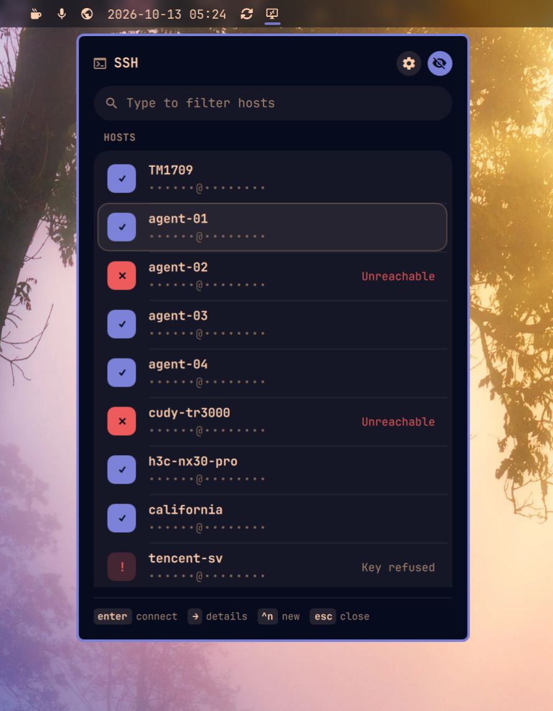
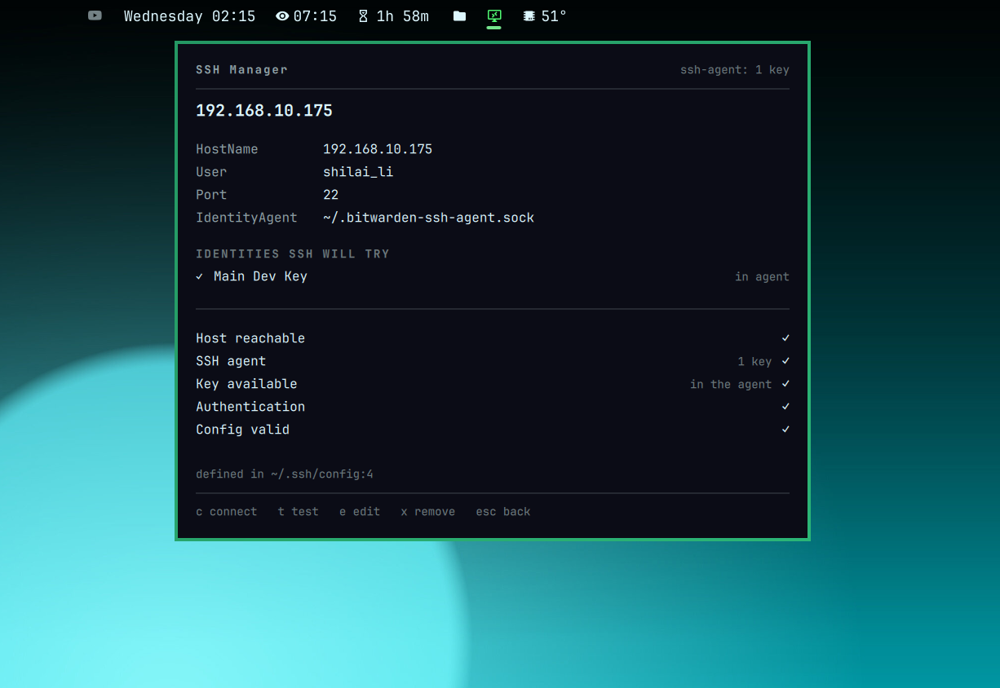

# Omarchy SSH Manager

The hosts in your `~/.ssh/config`, in the bar — with the answers to *why isn't
it connecting* next to each one. For [Omarchy](https://omarchy.org).



```
SSH Manager                                    ssh-agent: 1 key
Search hosts…
──────────────────────────────────────────────────────────────
● omarchy                                              ~/.ssh/id_ed25519
  shilai_li@192.168.10.175
● server                                                    Authenticated
  user@10.0.0.20
✕ devbox                                                      Unreachable
  dev@example.com
──────────────────────────────────────────────────────────────
↑↓ move   enter connect   → details   ^t test   ^n new   type to filter
```

- **It runs the real ssh client.** `ssh -G` for the effective configuration,
  `ssh -o BatchMode=yes` for authentication, `ssh-add -l` for the agent.
  Nothing about SSH is reimplemented here.
- **It never handles a credential.** Every probe runs with `BatchMode=yes`,
  `PasswordAuthentication=no` and `KbdInteractiveAuthentication=no`: ssh fails
  where it would otherwise prompt. No password is read, stored, forwarded or
  cached — by design, not by policy.
- **Your file stays your file.** Edits rewrite the lines they must and copy
  every other line — comments included — through untouched, and an edit made
  against a copy someone else has since changed is refused rather than applied.
- **No Electron.** QML running inside the `omarchy-shell` process you are
  already running.
- **Themed.** No hardcoded colors or sizes; it repaints itself when you run
  `omarchy theme set`.

---

## Install

```bash
omarchy plugin add https://github.com/shilai-li/omarchy-ssh-manager.git --enable
```

Or by hand, from a clone:

```bash
cp -r . ~/.config/omarchy/plugins/shilai_li.ssh-manager
omarchy-shell shell rescanPlugins
omarchy plugin enable shilai_li.ssh-manager
```

The widget lands on the right of the bar. Move it with `omarchy bar move`.

> Plugins run unsandboxed inside your shell. Read the code before you enable
> it — this one reads and writes `~/.ssh/config`, so that goes double.

## Uninstall

```bash
omarchy plugin remove shilai_li.ssh-manager
```

Nothing else to clean up: this plugin keeps no state of its own.

---

## The interface

### The list

Every `Host` entry ssh reads, including the ones in `Include`d files, in the
order ssh reads them. Wildcard entries (`Host *`) sort to the bottom and are
marked as patterns — they are not somewhere to connect, but they are usually
where a surprising value came from.

| Mark | |
|---|---|
| `○` | not tested yet |
| `●` | answered and authenticated |
| `◑` | answered, but refused the key |
| `✕` | unreachable |

Nothing is tested until you ask. Opening the panel makes no network
connection.

| Key | |
|---|---|
| `↑` `↓` | move |
| `enter` | connect in a terminal |
| `→` | details |
| `^t` | test the selected host |
| `^n` | new host |
| `^e` | edit the selected host |
| `delete` | remove the selected host (asks first) |
| anything else | filters the list |
| `esc` | clear the filter, then close |

**Left click** a row to connect, **right click** for details.

### Details



```
omarchy

HostName       192.168.10.175
User           shilai_li
Port           22

IDENTITIES SSH WILL TRY
✓ ~/.ssh/id_ed25519                                   on disk

Host reachable                                              ✓
Key available                                   on disk     ✓
Authentication                                              ✓
Config valid                                                ✓

defined in ~/.ssh/config:4
```

The values come from `ssh -G <host>`, so they are what ssh will actually use —
`Include`s, `Match` blocks and wildcards already resolved.

**Identities ssh will try** is the part `ssh -G` cannot tell you on its own: it
lists the six default key names whether or not they exist and says nothing
about the agent. This list is the keys that are really there, in the order ssh
will offer them, each marked `on disk`, `in agent`, or `missing`.

A dash in the checklist means *not asked*, never *fine*. `Host reachable` and
`Authentication` stay dashed until you press `t`.

An ssh-agent is optional, and not running one is not a fault. The agent counts
only where it is the source of a host's key, and that shows in `Key available`.
It is mentioned on its own only for a host with `ForwardAgent yes` and no agent
to forward. A host whose `IdentityAgent` names another socket is never credited
with the keys in `SSH_AUTH_SOCK`'s agent; its `Key available` stays a dash,
because nothing here asks that agent what it holds.

| Key | |
|---|---|
| `c` / `enter` | connect |
| `t` | test this host |
| `e` | edit |
| `n` | new host |
| `x` | remove (asks first) |
| `esc` / `←` | back to the list |

### Adding and editing

Five fields — `Host`, `HostName`, `User`, `Port`, `IdentityFile` — because
those are the five this plugin claims to manage. Everything else in a block is
preserved exactly: `ProxyJump`, `ForwardAgent`, a keyword this plugin has
never heard of, and every comment inside and around the entry.

A new entry is written **above the first wildcard block**. ssh takes the first
value it obtains for each keyword, so an entry appended after `Host *` would
silently lose every keyword that block sets — the most common way a
hand-edited `ssh_config` stops doing what it looks like it does.

A save is a transaction. The new text is written to a fresh file in `~/.ssh` at
mode `0600` *before* it holds anything, and renamed over the old one; a reader
sees one version or the other and never a half-written file, and there is no
moment where the new one is readable by anyone else. `~/.ssh` itself is created
`0700` if it is not there, one directory at a time, and is checked before every
write — not created with `mkdir -p`, which would follow a symlink anybody could
have put on the way. If the file changed on disk between being read and being
saved, the save is refused and the panel reloads: whoever edited it in the
meantime keeps their edit.

---

## What it can tell you

| Finding | Where it comes from |
|---|---|
| Missing `IdentityFile` | a path your config names that is not on disk |
| Duplicate `Host` entries | the same name declared in two places, with both files and line numbers |
| Overridden values | a keyword set in a file that lost to an earlier one — ssh takes the first, not the last |
| Unreachable host | a TCP connection to the effective `hostname:port` |
| Authentication failure | `ssh -o BatchMode=yes <host> true`, classified by ssh's own message |
| Which key ssh will use | `ssh -G` identity list, filtered by what exists, cross-referenced with `ssh-add -l` fingerprints |
| Broken config | `ssh -G` refusing to parse, quoting its own error |

A `Host *` block losing to a host that names itself is *not* reported: that is
ssh working as intended, and reporting it would bury the real conflicts.

A host behind a `ProxyJump` is not called unreachable — the jump host is what
reaches it, so the TCP check is skipped rather than failed.

---

## Command line

```bash
omarchy-shell shilai_li.ssh-manager toggle
omarchy-shell shilai_li.ssh-manager refresh
omarchy-shell shilai_li.ssh-manager connect <host>
omarchy-shell shilai_li.ssh-manager test <host>    # opens the panel and asks
omarchy-shell shilai_li.ssh-manager status         # JSON
```

That socket is reachable by anything running as you, and unlike the panel there
is nobody at a keyboard behind it, so it is deliberately narrower than the
panel:

- `connect` and `test` take only a `Host` alias that is in your config right
  now, spelled exactly, and not a pattern. Neither will accept an arbitrary
  destination.
- `test` opens a TCP connection and offers a key to whatever answers, so it
  does not do it on its own: it raises the panel on that host and asks. Press
  `t` on a host yourself and it just runs — that keystroke *is* the answer.
- `status` reports which aliases exist, how many hosts and files there are, and
  whether an agent is running. It does not report hostnames, usernames, ports,
  key paths, file paths, key fingerprints or agent key comments. An inventory of
  where your infrastructure is and which keys open it is worth a great deal to
  somebody who should not have it and very little to a shell script.

A Hyprland bind:

```
bindd = SUPER CTRL, S, SSH manager, exec, omarchy-shell shilai_li.ssh-manager toggle
```

The scripts in `bin/` are the whole backend and run fine on their own:

```bash
bin/scan.sh ~/.ssh/config          # the config as ssh reads it, includes expanded
bin/effective.sh myhost            # ssh -G, plus which identity files exist
bin/probe.sh myhost                # TCP reachability and authentication
bin/agent.sh                       # what the ssh-agent is holding
bin/config-read.sh ~/.ssh/config   # the file, if it is safe to read
bin/config-write.sh ~/.ssh/config <digest>   # replace it, against that digest
```

`effective.sh` and `probe.sh` take an optional trailing config path (`-F`),
which is how the test suite points them at a fixture instead of your real
`~/.ssh`. `bin/guard.sh` is sourced by all of them and holds the two things
none of them may get wrong: what has to be true about a path before it is
opened, and the ceilings on how much any of them may read, spawn or spend.

---

## What it will not do

`~/.ssh/config`, everything it `Include`s, and the socket this plugin listens
on are all reachable by anything else running as you. It is written on that
assumption.

| | |
|---|---|
| Open a config file by name and trust it | Every path is checked before it is opened: not a symlink, no symlink on the way to it, a regular file rather than a FIFO or a device, owned by you or by root, and small enough to be a config. |
| Read without a ceiling | Bytes, lines, line length, file count, `Include` depth and wall-clock all have a limit, and an `Include` cycle is not walked twice. Hitting a limit is a note in the panel saying the view is partial. |
| Run without a deadline | Every helper is one of this plugin's scripts, started by an absolute `/usr/bin/bash` with a fixed `PATH`, in its own process group, under a deadline that kills the group — a `ProxyCommand` outliving the ssh that spawned it does not get to outlive the test. |
| Resolve a tool through your `PATH` | `ssh`, `ssh-add`, `ssh-keygen`, `setsid` and the rest come from a fixed `/usr/bin:/bin`. Your terminal still gets your own environment when you connect. |
| Touch the network without you | Opening the panel runs the config scan and `ssh-add -l`, and nothing else. A probe happens on a keystroke, or on a confirmation you clicked. |

---

## Deliberately not here

No password storage, no SFTP browser, no SCP GUI, no remote file editing, no
remote monitoring, no built-in terminal. Connecting hands the host to your
default terminal running the system `ssh`; everything after that is between you
and the host.

---

## Development

```bash
omarchy plugin validate .
QT_FORCE_STDERR_LOGGING=1 /usr/lib/qt6/bin/qmllint -I /usr/share/omarchy/shell BarWidget.qml
bash test/test.sh
```

`SshConfig.js` (parsing and file surgery) and `Diagnostics.js` (reading ssh's
answers) are Qt-free so the suite runs under plain `node`. The shell scripts
are tested by running them against a throwaway `~/.ssh`; no test connects to a
host that exists.

See [AGENTS.md](AGENTS.md) for the plugin contract, architecture notes and
house style.

## License

MIT. See [LICENSE](LICENSE).
